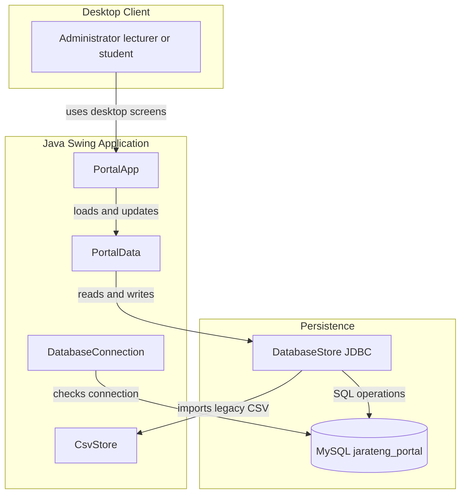
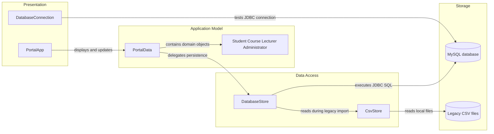

# Architecture Diagram

The Student Registration System is a local Java Swing desktop application backed by MySQL. It has a compact UI, application model, and JDBC persistence layer, with CSV support for legacy-data import.

## Application Architecture

<!-- mermaid-checked: no \n, no em-dash/en-dash, no {} in labels, subgraphs are id["label"], arrows are -->|"label"|, all subgraphs closed by end, ids unique -->

### Technology Stack Summary

| Layer | Technology | Version | Purpose |
| --- | --- | --- | --- |
| Runtime | Java | Compiler release 25; JDK 25 per README | Runs the desktop application |
| Presentation | Swing | JDK standard library | Desktop user interface |
| Application | Java classes | Project source code | Role workspaces and in-memory model |
| Persistence | JDBC and MySQL Connector/J | Connector/J 9.2.0 | Connects Java to MySQL |
| Database | MySQL Server | 8 or later per README | Stores student and account, lecturer, curriculum, assessment, timetable, and announcement data |
| Build | Apache Maven | `pom.xml` declares Maven plugins | Compiles and runs the application |
| Legacy import | CSV and Java NIO | JDK standard library | Reads existing local CSV records during initialization |

### Data Storage & External Services

The application uses a local MySQL database named `jarateng_portal` by default. It creates its schema during startup and uses JDBC for persistence. `CsvStore` is used to read legacy student and lecturer files from `.jarateng-portal` in the user's home directory when the database has not yet been initialized. Timetable entries and announcements are stored in MySQL with the other portal data. There are no external APIs, caches, or message brokers in the current implementation.

### Key Architectural Decisions

- The application is a single-process Swing desktop program with role-specific screens.
- `PortalData` acts as the in-memory model; `DatabaseStore` centralizes JDBC schema setup, reads, writes, and administrator authentication.
- MySQL is the persistent store; CSV is retained as a legacy import path, not the current primary persistence layer.

## Component Relationships

<!-- mermaid-checked: no \n, no em-dash/en-dash, no {} in labels, subgraphs are id["label"], arrows are -->|"label"|, all subgraphs closed by end, ids unique -->

### Component Inventory

| Component | Layer | Type | Responsibility |
| --- | --- | --- | --- |
| `PortalApp` | Presentation | Swing application class | Starts the UI, handles role sign-in, builds role-specific pages, and triggers persistence. |
| `DatabaseConnection` | Presentation/tooling | Standalone connection test | Tests the configured MySQL connection without opening the portal. |
| `PortalData` | Application model | In-memory data model | Holds students, courses, lecturers, timetable entries, and announcements and delegates loading/saving. |
| `Student`, `Course`, `Lecturer`, `Administrator`, timetable and announcement models | Application model | Nested domain classes | Represent registration, student sign-in state, curriculum, teaching allocation, schedule plans, notices, and administrator identity. |
| `DatabaseStore` | Data access | JDBC store | Creates tables; reads and writes MySQL records; verifies administrator and student credentials. |
| `CsvStore` | Data access/import | CSV reader/writer | Loads legacy student and lecturer records from local CSV files. |
| MySQL `jarateng_portal` | Storage | Relational database | Persists curriculum, student accounts, lecturer, administrator, metadata, assessment, timetable, and announcement data. |
| Legacy CSV files | Storage/import | Local files | Optional first-initialization source for older student and lecturer data. |
