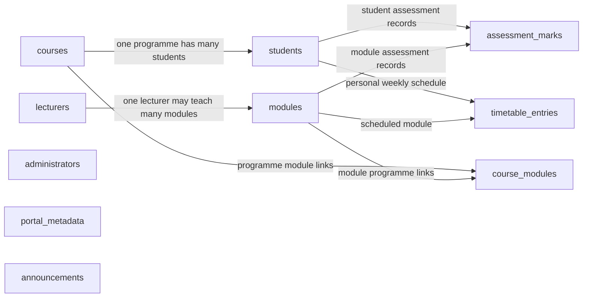
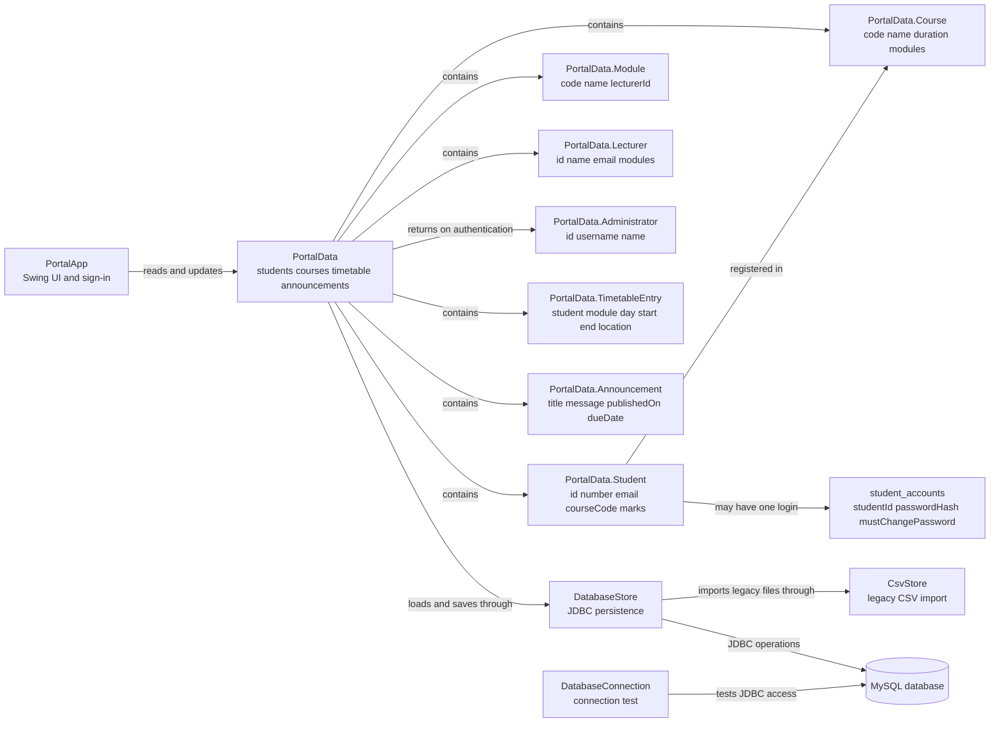

# Student Registration System - Project Documentation

## 1. Purpose and scope

The Student Registration System is a Java desktop demonstration for managing student records, academic programmes, lecturers, module allocations, assessment marks, personal timetable plans, and campus announcements. It uses a Swing graphical interface and stores application data in a local MySQL database.

This document describes the current implementation for learning and system-analysis purposes. It is not a production specification: authentication, role management, data governance, backups, and operational controls are simplified or incomplete.

## 2. Project objectives

- Keep a central register of students and their programme registrations.
- Let an administrator maintain student and lecturer records.
- Give students a progress dashboard, assessment insights, next steps, and a personal timetable.
- Let administrators publish campus announcements and deadline reminders for students.
- Show students the modules in their programme and their assessment results.
- Let lecturers view students in assigned modules and capture marks.
- Persist application records in MySQL, with a one-time import path for legacy CSV files.

## 3. Stakeholders and user roles

| Stakeholder | Current system capabilities |
| --- | --- |
| Administrator | View an overview; add, edit, and remove student records; create courses and modules; assign modules to courses and a single lecturer; add and remove lecturers; publish and remove campus announcements with optional deadlines. |
| Lecturer | View allocated modules and students in those modules; capture up to four assessment marks per module; view campus announcements. |
| Student | View a study dashboard, suggested next steps, assessment averages and trends, profile, programme modules, results, announcements, and a personal timetable with overlap checking. |
| System operator | Install Java, Maven, and MySQL; create the database; configure the database connection; back up the local database. |

In normal MySQL-backed mode, student accounts are provisioned by an administrator from the student directory. The student number is the username; accounts use the shared temporary password `Welcome@1234`, which must be changed on first sign-in. Only its salted PBKDF2 hash is stored. Students can change their password from their profile, and administrators can reset an account to the shared temporary password. This shared password is for local demonstration only and is not appropriate for real or production accounts. The built-in student demo sign-in is limited to session-only demo mode; the lecturer demo sign-in remains built in. The administrator account is stored in MySQL with a salted PBKDF2 hash. This remains demonstration authentication, not a production identity or authorization system.

## 4. System analysis

### 4.1 Functional requirements

| ID | Requirement | Primary role |
| --- | --- | --- |
| FR-01 | View an overview of registration and academic information; for students, include recorded-mark progress and next steps based on available records. | All |
| FR-02 | Register a student with a generated student number, contact details, programme, status, and enrollment date. | Administrator |
| FR-03 | Edit or remove an existing student record. | Administrator |
| FR-04 | Create courses and modules, assign one or more modules to a course, and share a module across courses. | Administrator |
| FR-05 | Add and remove lecturers, assign at most one lecturer to each module, and view teaching allocations. | Administrator |
| FR-06 | View assigned modules and the students taking them. | Lecturer |
| FR-07 | Capture four assessment marks per student and module. | Lecturer |
| FR-08 | View a student's profile, modules, and marks. | Student |
| FR-09 | Save student, lecturer, curriculum, mark, timetable, and announcement records to MySQL. | System |
| FR-10 | Import existing student and lecturer CSV data when initializing an empty database. | System |
| FR-11 | Let students create and remove weekly timetable entries for their enrolled modules, rejecting overlapping entries on the same day. | Student |
| FR-12 | Let administrators publish and remove campus announcements; let students and lecturers view them. | All |
| FR-13 | Show student assessment averages, mark coverage, module status and available assessment trends; surface incomplete marks, low averages, registration status, and announcement deadlines as next steps. | Student |
| FR-14 | Let administrators create or reset student accounts using a shared temporary password; require students to set a private password on first sign-in and allow later password changes. | Student / Administrator |

### 4.2 Quality attributes and constraints

- **Usability:** a role-based Swing desktop interface with forms, tables, keyboard-accessible controls, and scrollable pages that remain usable at smaller window sizes.
- **Persistence:** MySQL is the normal persistent store; legacy CSV files are only an initialization/import source.
- **Data integrity:** primary keys, unique student numbers and email addresses, foreign keys, mark range checks, timetable time checks, and application-level overlap validation protect stored records.
- **Portability:** Maven declares Java 25 as the compiler release and manages the MySQL JDBC driver.
- **Security limitation:** the application defaults to a local `root` MySQL login unless `MYSQL_USER` is configured. Demo student and lecturer credentials are built into the program. Do not use real student information or expose the demo credentials publicly.
- **Operational limitation:** this is a single-computer demonstration, not a multi-user hosted system. It does not provide production backup, audit, privacy, or deployment procedures.

### 4.3 Main use-case flows

**Administrator registers a student**

1. Sign in to the Administrator workspace.
2. Open **Students** and choose **Register student**.
3. Enter the student's name and email; select a programme and status.
4. The system checks required fields and email format, assigns an ID/student number, and records the enrollment date.
5. The system persists the updated records to MySQL and refreshes the screen.

**Administrator maintains the curriculum**

1. Open **Courses** and add a course using its unique code, name, and duration.
2. Create modules with unique codes and names; choose one or more courses and optionally one lecturer.
3. Use **Assign modules to selected course** to share an existing module with additional courses.
4. Use **Assign lecturer to selected module** to assign, change, or clear the module's single lecturer.
5. The course/module relationship is stored in `course_modules`; the optional lecturer foreign key is stored on `modules`.
6. In session-only demo mode, the same curriculum actions work in memory, and the UI warns that changes are temporary.

**Lecturer records marks**

1. Sign in to the Lecturer workspace.
2. Open **Capture marks** and select an assigned module/student.
3. Enter assessment scores (the database allows values from 0 to 100 and assessment numbers 1 to 4).
4. Save the change; the application persists the updated data.

**Student views results**

1. Sign in to the Student workspace.
2. Open **Academic results**.
3. The application displays the student's module assessment results.

**Student plans a weekly timetable**

1. Open **Timetable** and choose **Add class**.
2. Select an enrolled module, day, 24-hour start and end times, and optional location.
3. The application rejects invalid time ranges and any overlap with another class on that day.
4. The saved entry appears in the weekly timetable and remains available after signing in again.

**Administrator publishes an announcement**

1. Open **Announcements** and choose **Publish announcement**.
2. Enter a title and message, with an optional deadline in `YYYY-MM-DD` format.
3. The announcement appears in the student and lecturer workspaces; student next steps surface deadlines that are due or approaching.

## 5. System design and architecture

The application is a monolithic desktop program. The Swing interface calls the application/data model directly; the `DatabaseStore` handles MySQL access using JDBC. `CsvStore` supports reading legacy CSV files during initialization.

See [architecture-diagram.md](../.github/modernize/assessment/engines/facts/architecture-diagram.md) for a high-level architecture diagram and component inventory.

### 5.1 Technology stack

| Area | Technology | Version/configuration | Use |
| --- | --- | --- | --- |
| Language/runtime | Java | Maven compiler release 25; README requires JDK 25 | Application implementation and JVM runtime |
| Desktop UI | Java Swing | JDK standard library | Login, role workspaces, forms, and tables |
| Build/dependency management | Apache Maven | Maven wrapper is not present | Compile and run the desktop application |
| Database | MySQL Server | README requires MySQL 8 or later | Persistent application records |
| Database access | JDBC and MySQL Connector/J | Connector/J 9.2.0 | Connect to MySQL and execute SQL |
| Local data import | CSV and Java NIO | JDK standard library | Read legacy student/lecturer files from the user's home directory |

### 5.2 Data flow and application lifecycle

1. `PortalApp.main` starts a session-only sample-data demonstration when invoked with `--demo`. Otherwise, it reads the `MYSQL_*` environment settings and prompts for the database password when `MYSQL_PASSWORD` is not set.
2. `PortalData.load` initializes the schema through `DatabaseStore`.
3. The system loads student, lecturer, course, module, mark, timetable, and announcement records from MySQL. If it has no initialized application data, it can read legacy CSV files or load fictional sample records, then persist the initial data.
4. The Swing interface presents pages for the signed-in role.
5. User changes are applied to the in-memory `PortalData` model and persisted through `DatabaseStore`.

The standalone `DatabaseConnection` class is a connection-check utility. It uses the same database URL and username configuration as the portal and verifies the selected database.

### 5.3 Configuration

| Environment variable | Default | Purpose |
| --- | --- | --- |
| `MYSQL_URL` | `jdbc:mysql://localhost:3306/jarateng_portal?connectionTimeZone=LOCAL` | JDBC URL for the database server and database |
| `MYSQL_USER` | `root` | MySQL account used by the application |
| `MYSQL_PASSWORD` | Not set | Optional database password; if missing, the UI prompts for it |

The database itself must exist before startup. The application creates its tables and initial records, but it does not create the MySQL database or MySQL login.

For a presentation that does not depend on MySQL, run `mvn compile exec:java "-Dexec.args=--demo"`. This mode uses fictional sample data, supports all three demo workspaces, and does not save changes after the application closes.

## 6. Database design

The schema is created by `DatabaseStore.initialize()`. In the ERD below, `PK` means primary key, `FK` means foreign key, and `UK` means unique key. Attributes and constraints are listed in the data dictionary.

<!-- mermaid-checked: no \n, no em-dash/en-dash, no {} in labels, subgraphs are id["label"], arrows are -->|"label"|, all subgraphs closed by end, ids unique -->


### 6.1 Data dictionary

| Table | Columns and constraints | Purpose |
| --- | --- | --- |
| `portal_metadata` | `metadata_key VARCHAR(64) PK`; `metadata_value VARCHAR(255) NOT NULL` | Stores the `application_initialized` marker used by the application startup flow. |
| `courses` | `course_code VARCHAR(24) PK`; `course_name VARCHAR(180) NOT NULL`; `duration VARCHAR(40) NOT NULL` | Academic programmes offered by the demonstration application. |
| `modules` | `module_code VARCHAR(24) PK`; `module_name VARCHAR(180) NOT NULL`; `lecturer_id INT NULL FK -> lecturers.id ON DELETE SET NULL` | Module catalogue; each module has zero or one assigned lecturer. |
| `course_modules` | `course_code VARCHAR(24) FK`; `module_code VARCHAR(24) FK`; composite `PK(course_code, module_code)` | Resolves the many-to-many relationship between programmes and modules. |
| `students` | `id INT PK`; `student_number VARCHAR(32) NOT NULL UK`; `first_name VARCHAR(100) NOT NULL`; `surname VARCHAR(100) NOT NULL`; `email VARCHAR(254) NOT NULL UK`; `course_code VARCHAR(24) NOT NULL FK`; `status VARCHAR(24) NOT NULL`; `enrollment_date DATE NOT NULL` | Student identity and registration information. The student ID is supplied by the application, not declared auto-increment. |
| `student_accounts` | `student_id INT PK and FK -> students.id ON DELETE CASCADE`; `password_hash VARCHAR(255) NOT NULL`; `must_change_password BOOLEAN NOT NULL DEFAULT TRUE`; `updated_at TIMESTAMP` | Student sign-in credentials and first-login password-change flag. Only the PBKDF2 hash is stored. |
| `lecturers` | `id INT PK`; `first_name VARCHAR(100) NOT NULL`; `surname VARCHAR(100) NOT NULL`; `email VARCHAR(254) NOT NULL UK` | Lecturer directory. |
| `assessment_marks` | `student_id INT FK`; `module_code VARCHAR(24) FK`; `assessment_number TINYINT`; `score TINYINT UNSIGNED`; composite `PK(student_id, module_code, assessment_number)`; checks `assessment_number` 1-4 and `score` 0-100 | Stores each student's mark for one assessment in one module. Deleting a student cascades to their mark rows. |
| `timetable_entries` | `id INT AUTO_INCREMENT PK`; `student_id INT FK`; `module_code VARCHAR(24) FK`; `day_of_week TINYINT` (1-7); `start_time TIME`; `end_time TIME`; `location VARCHAR(120)`; checks day and end-after-start; unique `(student_id, day_of_week, start_time)` | Stores a student's personal weekly planner entries; deleting a student or module cascades to their schedule rows. Overlap detection is performed by the application. |
| `announcements` | `id INT PK`; `title VARCHAR(160) NOT NULL`; `message VARCHAR(1000) NOT NULL`; `published_on DATE NOT NULL`; `due_date DATE NULL` | Campus announcements managed by administrators; optional due dates are used in student reminders. |
| `administrators` | `id INT AUTO_INCREMENT PK`; `username VARCHAR(64) NOT NULL UK`; `first_name VARCHAR(100) NOT NULL`; `surname VARCHAR(100) NOT NULL`; `password_hash VARCHAR(255) NOT NULL`; `created_at TIMESTAMP NOT NULL DEFAULT CURRENT_TIMESTAMP` | Administrator sign-in identity and salted password hash. |

### 6.2 Relationship rules

- One course can have many student records; each student record references one course.
- Courses and modules have a many-to-many relationship through `course_modules`, allowing shared modules and multi-module courses.
- Each module references at most one lecturer; a lecturer can teach multiple modules. The nullable foreign key keeps newly created or temporarily unassigned modules valid.
- A student can have marks for multiple modules, and a module can have marks for multiple students. `assessment_marks` stores the assessment number and score for each combination.
- Timetable entries belong to one student and one module. The timetable is student-managed planning information, not an official institutional schedule.
- Announcements are shared across roles; a nullable deadline supports student reminders without inventing due dates.
- Administrator accounts, announcements, and startup metadata are independent of student registration records.
- Each student may have one account. The student number is used as the login name; password hashes and the required-change flag are stored separately from profile data. Removing a student cascades to their account.
- Foreign keys in `course_modules`, `modules`, `students`, `assessment_marks`, and `timetable_entries` enforce the relationships. Deleting a lecturer clears a module's assignment; deleting a student cascades to their marks and timetable entries.
- Curriculum attributes are stored with their own primary keys; the course-module join contains only the two relationship keys. Lecturer assignment depends on the module key, avoiding duplicated lecturer data and the former many-to-many lecturer allocation table.
- Startup migrates the former `lecturer_modules` table into `modules.lecturer_id`. If legacy data assigned multiple lecturers to one module, the migration retains the lowest lecturer ID to satisfy the single-lecturer rule.

## 7. Class diagram and design

This simplified class diagram shows the key model classes, representative attributes, and source-level dependencies. It omits methods and UI widgets to keep the design readable.

<!-- mermaid-checked: no \n, no em-dash/en-dash, no {} in labels, subgraphs are id["label"], arrows are -->|"label"|, all subgraphs closed by end, ids unique -->


### 7.1 Class responsibility summary

| Class | Responsibility |
| --- | --- |
| `PortalApp` | Creates the Swing login and role-specific workspaces; validates demo student/lecturer credentials; provides the progress dashboard, timetable overlap checks, announcement board, and persistence actions. |
| `PortalData` | Holds students, courses, modules, lecturers, timetable entries, and announcements; provides lookups, sample data, and persistence delegation. |
| `PortalData.Student` | Represents a student and their per-module assessment scores in the in-memory model. |
| `student_accounts` | Stores the student's PBKDF2 password hash and whether the temporary password must be changed. |
| `PortalData.Course` | Represents a programme and its configured modules. |
| `PortalData.Module` | Represents a module and its optional single lecturer assignment. |
| `PortalData.Lecturer` | Represents a lecturer and their assigned modules. |
| `PortalData.Administrator` | Carries the administrator identity returned after successful authentication. |
| `PortalData.TimetableEntry` | Represents a student's weekly class slot and location. |
| `PortalData.Announcement` | Represents a campus notice with its publication date and optional deadline. |
| `DatabaseStore` | Creates tables, authenticates administrators, reads/writes MySQL records, and imports legacy CSV data through `CsvStore`. |
| `CsvStore` | Reads and writes legacy student and lecturer CSV files using UTF-8 and safe temporary-file replacement. Current database persistence is handled by `DatabaseStore`. |
| `DatabaseConnection` | Provides a standalone UI-based check of the configured JDBC connection. |

## 8. Software development life cycle (SDLC) view

The following describes how this project can be developed and maintained using a conventional iterative SDLC. It is a recommended process for the project, not a claim that every activity is already automated.

| SDLC activity | Application to this project | Evidence or next action |
| --- | --- | --- |
| Planning | Define users, scope, risks, and the demonstration boundary. | Keep the local-demo limitation explicit; identify privacy and data-loss risks before expanding use. |
| Requirements analysis | Capture role-based actions, required student fields, curriculum relationships, mark rules, and error cases. | Use the functional requirements in this document as a starting baseline and confirm them with intended users. |
| System analysis and design | Model workflows, classes, database entities, constraints, and security boundaries before implementation. | Review the ERD and class diagram when changing the schema or adding user roles. |
| Implementation | Build the Swing UI, domain model, and JDBC persistence in small changes. | Keep database operations parameterized and preserve the source/schema mapping. |
| Verification and testing | Compile, test validation rules, test database persistence, and exercise each role's workflows. | Add automated tests for login, student CRUD, allocations, mark limits, schema initialization, and error handling; no test source files were found in this project during documentation. |
| Deployment | Install a supported JDK, Maven, and MySQL; configure the database and least-privilege app account. | Avoid `root` for routine app access; configure the URL, username, and secret outside source control. |
| Operation and maintenance | Back up data, review failures, patch dependencies, and migrate schema carefully. | Document backup/restore steps before storing any real or important records. |

### 8.1 Suggested validation checklist

- Confirm MySQL is running and `jarateng_portal` exists.
- Start the application with the configured database account and confirm schema initialization.
- Sign in to each demonstration workspace and verify its permitted screens.
- Register, edit, and remove a test student; restart the app and confirm the intended persistence.
- Enter marks at the allowed boundaries (0 and 100) and check that out-of-range values are rejected.
- Confirm each student is assigned to a valid course and marks reference existing students and modules.
- Test incorrect passwords, duplicate email addresses, missing fields, and a database connection failure.
- Back up and restore a disposable test database before relying on database operations.

## 9. Project plan

This is a small, presentation-focused plan for completing and demonstrating the local student registration system. Estimates assume one primary developer, existing development equipment, and access to a MySQL installation. Time and cost are planning estimates, not measured project actuals.

### 9.1 Scope

**Included**

- Deliver the Java Swing student, lecturer, and administrator workspaces.
- Manage student registrations, courses, modules, course-module assignments, lecturer allocations, and assessment marks.
- Store persistent records in MySQL and provide a session-only sample-data mode for presentations that cannot rely on a database connection.
- Verify the key workflows, document setup and demo instructions, and prepare a short presentation.

**Excluded**

- Production hosting, multi-user concurrency guarantees, and high availability.
- Real student data, institutional identity integration, and production-grade authentication or authorization.
- Mobile/web clients, payment processing, and integrations with external academic systems.
- Production backup operations, formal privacy/compliance certification, and ongoing support.

### 9.2 Time estimate

| Phase | Estimated duration | Main outcome |
| --- | --- | --- |
| Requirements and scope confirmation | 2 days | Confirm roles, demo scenarios, assumptions, and exclusions. |
| Design and database preparation | 3 days | Review the data model, relationships, and MySQL setup. |
| Implementation and documentation | 8 days | Complete the UI workflows, persistence, demo mode, and user/project documentation. |
| Verification and rehearsal | 4 days | Run the build, check each role and key workflow, prepare sample data, and rehearse the presentation. |
| **Total** | **17 working days (about 3-4 weeks)** | **Presentation-ready local demonstration.** |

These are elapsed working-day estimates for a small project with one primary developer; stakeholder feedback or database setup delays may extend the schedule.

### 9.3 Cost estimate

| Cost item | Planning estimate | Assumption |
| --- | --- | --- |
| Java Development Kit | R0 | Use an existing supported JDK distribution. |
| Apache Maven | R0 | Use the existing installation or the free Apache Maven distribution. |
| MySQL Community Server | R0 | Use a local community edition installation. |
| IDE and source control | R0 | Use existing development tools and repository hosting. |
| Equipment, electricity, and internet | Not included | Existing equipment and connectivity are assumed. |
| Developer and stakeholder time | Not priced | Labour rates and whether the work is paid are not specified. |
| **Estimated software/tooling total** | **R0** | **Excludes labour, equipment, connectivity, and any paid services.** |

The estimate is indicative and should be updated if paid services, new equipment, or labour charges are required.

### 9.4 People and responsibilities

| Person/role | Suggested allocation | Responsibility |
| --- | --- | --- |
| Project lead / developer | 1 person | Confirm scope, implement the app, maintain documentation, and coordinate readiness. |
| Administrator / registrar representative | 1 reviewer, part-time | Validate student, course, module, and lecturer management workflows. |
| Lecturer representative | 1 reviewer, part-time | Validate teaching allocations, student lists, and mark capture. |
| Student representative | 1 reviewer, part-time | Validate the student profile, module list, and results screens. |
| Database / presentation support | 1 person as needed; may be the developer | Prepare MySQL or session-only demo mode, check the presentation setup, and help with rehearsal. |

For a classroom-sized project, one person may cover multiple roles. Reviewers provide feedback; the project lead remains accountable for implementation and the final demonstration.

## 10. Known limitations and future improvements

1. Replace built-in student and lecturer demo sign-ins with database-backed accounts, secure password hashing, and explicit role authorization.
2. Default to a dedicated least-privilege MySQL account; keep secrets out of source code and version control.
3. Add automated unit and integration tests, including database schema and persistence tests.
4. Add edit and delete workflows for courses and modules, including safe handling of existing student registrations, marks, and course-module links.
5. Review the current save strategy before multi-user use: the persistence layer rewrites the student collection in a transaction, which is suitable only for the small local demonstration.
6. Add data backup/restore, audit history, privacy controls, and a documented schema migration strategy before handling real student information.

## 11. Run and reference

From the project directory, compile and run the desktop application with:

```powershell
mvn compile exec:java
```

To present without MySQL, use the session-only sample-data mode:

```powershell
mvn compile exec:java "-Dexec.args=--demo"
```

The database setup, environment variables, demo usage, and connection-test command are documented in the [project README](../README.md). The configured main class is `edu.jarateng.portal.PortalApp`.
